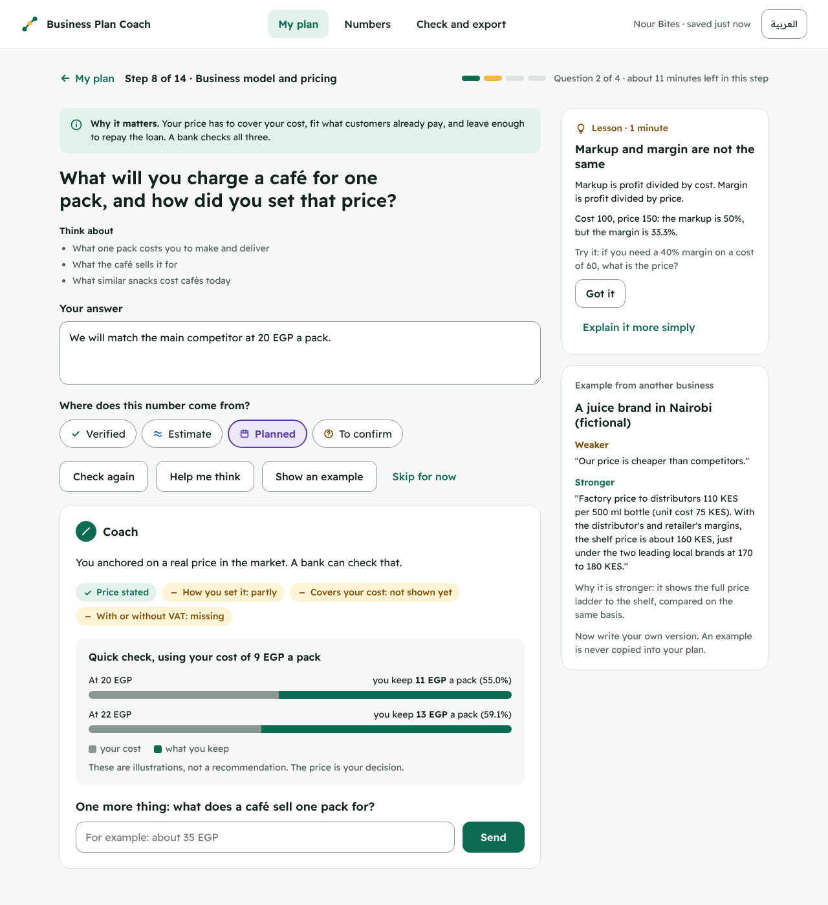

# Business Plan Studio

  

**An interactive business plan mentor for Claude: four Agent Skills that coach founders of any business, in English or Arabic, from first idea to a plan a bank, investor, incubator or grant programme will trust.**

Created by **AlRawaabit (Wessam Zidan)**. Licensed under Apache 2.0. Version 2.2.0.

## What it does

Business Plan Studio turns Claude into a patient, sharp business mentor. Instead of filling a template for you, it builds the plan *with* you:

- **One question at a time.** You answer first; Claude explains why each part matters, checks your answer, and offers a tighter version in your own words.
- **Teaches as you go.** 62 micro-lessons (break-even, unit economics, TAM/SAM/SOM, cash flow, CAC and LTV...) at your level: "new to this", "some experience" or "experienced, challenge me".
- **Examples when you need them.** Weak and strong answers for every section, from fictional businesses in many sectors and countries, plus native Arabic examples and a complete worked case.
- **Any business.** Tailored questions, drivers, red flags and model templates for 10 business types: services, software and subscriptions, e-commerce, retail shops, food service, manufacturing, trade and distribution, marketplaces, clinics/salons/gyms/training/tours, and social enterprises.
- **Any reader.** Module order, emphasis and length adapt to incubators, banks, investors, grant programmes, partners or an internal plan.
- **Numbers you can defend.** Tested calculators do all arithmetic: a monthly financial model with cash flow, break-even, scenarios, sensitivity and funding need (with optional Excel export), plus 14 consistency checks (price vs cost, capacity, market size vs forecast, cash floor, funding ask, use of funds...).
- **Honest by design.** Every claim is labelled Verified, Estimate, Planned or To confirm. Nothing is invented; market facts are researched with sources and dates, and tax or legal points become questions for your accountant or lawyer.
- **Remembers your progress.** A small `plan_state.json` file keeps your answers, numbers, assumptions and open questions, so you can stop and continue later, even in a new chat.
- **Ready-to-use outputs.** Full plan for your reader, one-page summary, Business Model Canvas or Lean Canvas, pitch deck outline, a paste pack for online application forms, and registers of assumptions, open questions and actions.

## The four skills

| Skill | Use it for |
|---|---|
| `business-plan-coach` | The guided journey: intake, plan map, coaching, teaching, examples, checks and outputs. Start here. |
| `business-plan-financials` | Building or fixing the numbers: pricing, unit economics, break-even, monthly cash flow, scenarios, funding need, loans and equity. |
| `business-plan-market-research` | Market sizing (TAM, SAM, SOM), competitors, customer interviews and local rules, with cited sources. |
| `business-plan-review` | A mentor, bank, investor or grant officer's review of an existing plan: scores, red flags, number checks and a ranked fix list. |

Each skill works on its own; together they share the same plan file.

## Install

Each skill is a folder containing `SKILL.md`, in the open Agent Skills format. The steps for every agent are in [INSTALL.md](INSTALL.md); this is the short version.

**Let your agent install it.** If your agent can run commands on your computer (Claude Code, Codex, OpenCode, Antigravity, Hermes and similar), paste this:

> Install Business Plan Studio from https://github.com/wessamzidan/business-plan-studio. Read AGENTS.md in that repository and follow it. Tell me what you will copy and where before you do it.

**Claude.ai (web, desktop, mobile)**
1. Turn on code execution and file creation in Settings. The calculators need code execution.
2. Open Customize, then Skills (claude.ai/customize/skills), and choose to upload a skill.
3. Upload each ZIP from `claude-ai-uploads/` (start with `business-plan-coach.zip`) and switch the skills on. If you have an older `business-plan-coach` skill, delete it first.
Availability of custom skills depends on your plan; see Anthropic's help centre.

**Claude Cowork (desktop app)**
Open `business-plan-studio.plugin` in a Cowork chat and accept the plugin, or upload the skill ZIPs as above.

**Claude Code**
- As a plugin from GitHub: run `/plugin marketplace add wessamzidan/business-plan-studio`, then `/plugin install business-plan-studio@alrawaabit-business-plan-studio`.
- From this folder: run `python3 install.py --agent claude-code`. It copies the four skill folders into `~/.claude/skills/`. Add `--project PATH` to install into one project instead.

**Codex, OpenCode, Antigravity, Hermes and other agents**
Run `python3 install.py --agent codex` in this folder (or `opencode`, `antigravity`, `hermes`). It copies the four skill folders into that agent's skills folder and changes nothing else. `python3 install.py --list` shows every agent it knows, and `--dest PATH` installs into any other skills folder. You need Python 3 on your computer for the calculators. The skills were built and tested with Claude; in other agents they use the same open format but have not been run there yet.

**Claude API**
Upload each skill folder with the Skills API (`/v1/skills`) and attach the skill ids to your requests with the code execution tool. API containers have no internet access, so market research falls back to the founder's own sources.

## Try it

- "Help me write a business plan for my bakery in Alexandria. I'm new to this."
- "أريد أن أكتب خطة عمل لمشروع مطبخ سحابي في الرياض لتقديمها إلى بنك."
- "Quick draft of a plan for my cleaning company; I have 15 minutes."
- "Build a 24-month cash flow for my SaaS and tell me how much funding I need."
- "How big is the market for school uniforms in Nairobi? Show your sources."
- "Review my plan as a bank would." (attach the plan)

Useful things to say during a session: *map* · *next* · *skip* · *later* · *example* · *explain break-even* · *simpler* · *challenge me* · *draft it for me* · *check my numbers* · *what's missing* · *export*.

## How a session works

1. **Start.** Say what your business is and where. The coach asks who will read the plan (a bank, an investor, an incubator, a grant programme), what stage you are at, and how much teaching you want.
2. **See your plan map.** The plan has 14 modules, in the order your reader cares about. A full plan takes about three hours over several sittings; a quick draft takes about fifteen minutes. You choose where to start.
3. **Answer one question at a time.** Each turn says where you are, why the question matters and what to think about. You answer first.
4. **Get feedback.** The coach checks your answer against a short checklist, asks at most two follow-up questions, and offers a tighter version in your own words. You keep it, edit it, or keep yours.
5. **Let it calculate.** Give your numbers one at a time. The scripts work out prices, break-even, cash flow and funding need, and 14 checks warn you when two numbers disagree.
6. **Stop when you like.** The coach recaps, tells you what to bring next time, and hands you a file called `plan_state.json`. Keep it.
7. **Come back.** A new chat has no memory. Give it `plan_state.json` and say "continue my plan".
8. **Export.** Say "export" for the full plan for your reader, a one-page summary, a canvas, a pitch deck outline, answers for an online form, and the model as a spreadsheet.

## Design concept

The skills work in chat today. This repository also holds a design for a guided app on top of them: one path of 14 steps in 5 sittings, one question at a time, in English and Arabic, on a phone or a laptop. It is a design only; nothing in it is built yet. See [`design/`](design/) for the specification and every screen.

## Privacy

Your plan stays in your conversation and in the `plan_state.json` file you download. The skills do not send data anywhere. They never ask for passwords, and they never press submit or send buttons on portals for you.

## Important

Business Plan Studio supports planning; it is not financial, tax, legal or investment advice. Tax and payroll rates are dated starting points to confirm with a qualified accountant. All example companies are fictional.

## Contributing

Issues and pull requests are welcome, especially new business types, country starting points, Arabic examples and calculator tests. See [CONTRIBUTING.md](CONTRIBUTING.md).

## Credits and licence

Created by AlRawaabit (Wessam Zidan), https://alrawaabit.com. Licensed under the Apache License, Version 2.0 (see `LICENSE`). If you share or adapt it, keep the `LICENSE` and `NOTICE` files.
