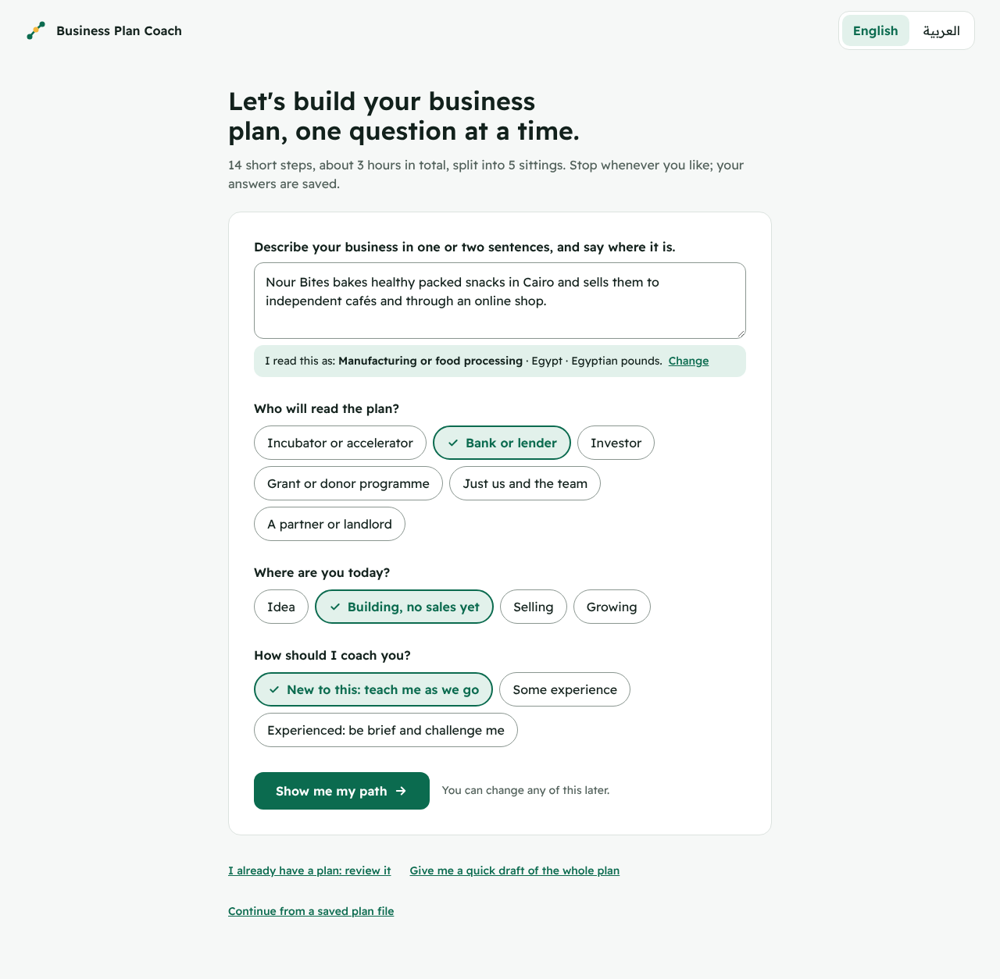
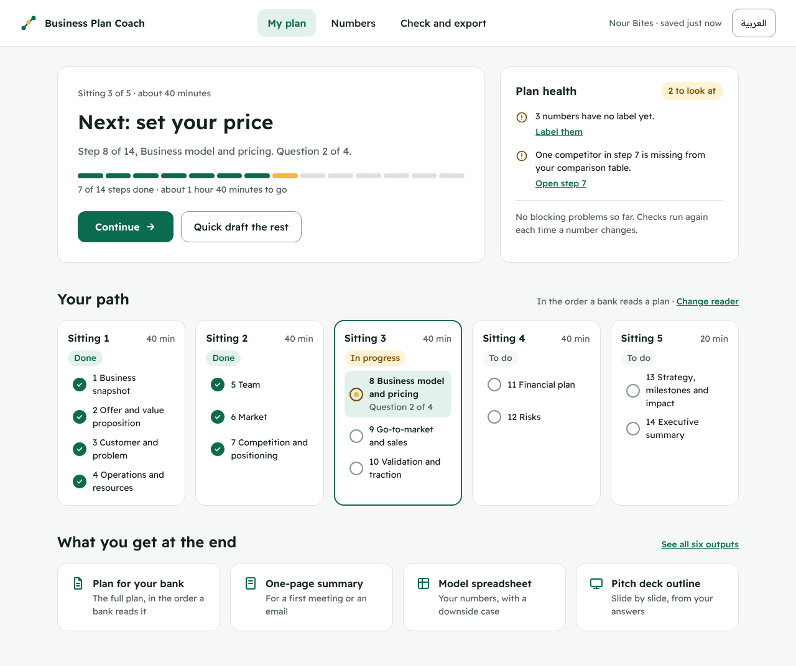
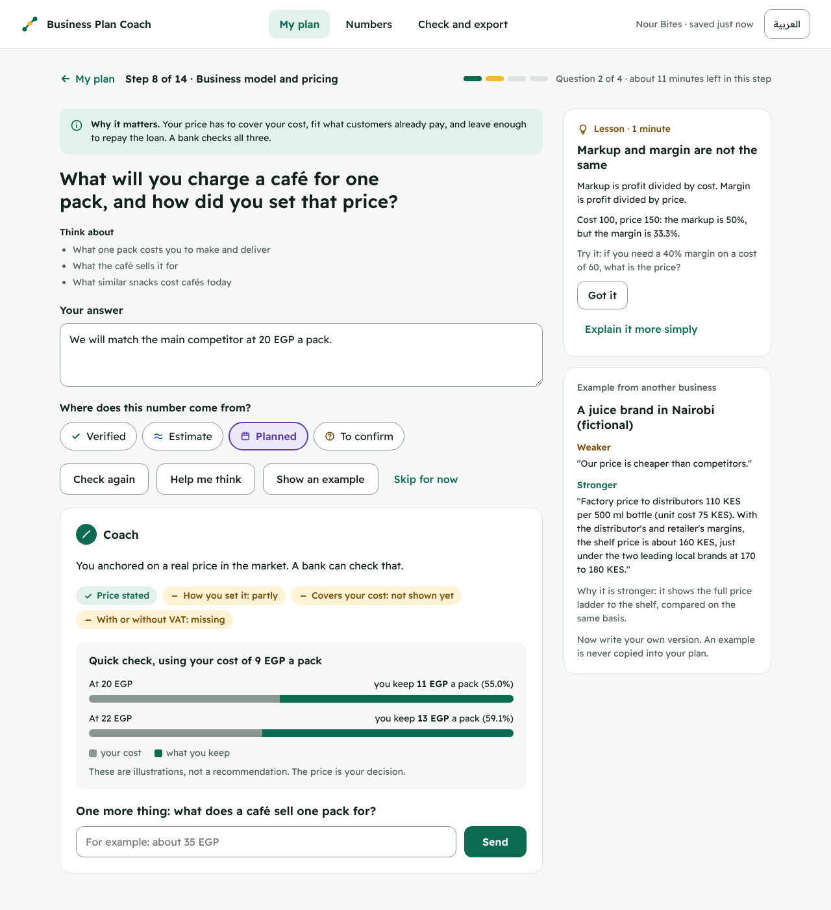
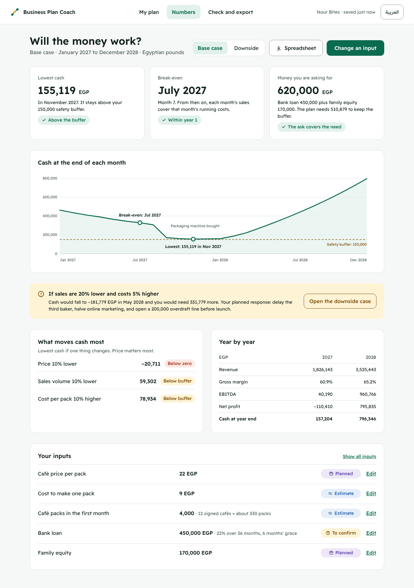
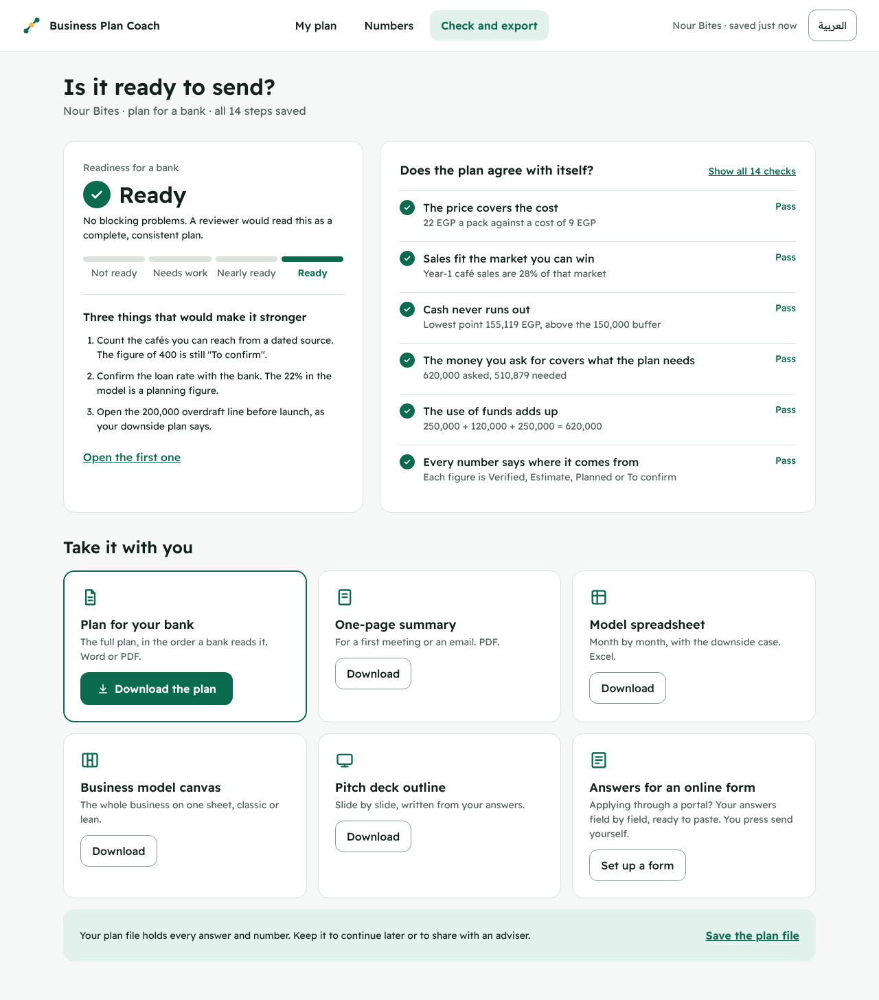
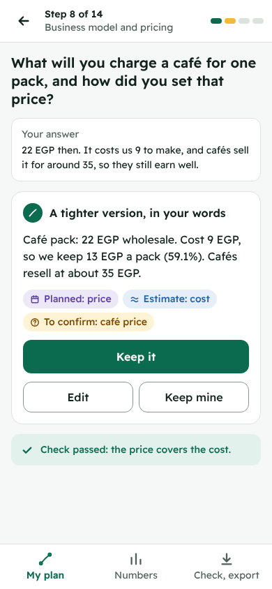
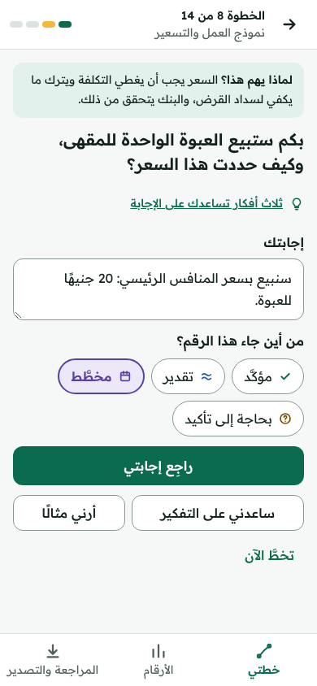

# Design concept: a guided app for Business Plan Studio

The four skills work in chat today. This folder holds a design for a guided app that could sit on top of them: one path of 14 steps in 5 sittings, one question at a time, in English and Arabic, on a phone or a laptop.

**It is a concept.** Nothing here is built. The screens use sample data from a fictional snack maker, Nour Bites, taken from the skills' own worked example. The readiness verdict and the plan-health notes on the last screen are illustrative, not computed. The screenshots were rendered from the mockup markup at 1280 px and 390 px wide.

The full specification is in [UI-UX-SPEC.md](UI-UX-SPEC.md). It ends with five open decisions, and section 9 maps every screen to the scripts that already ship in this repository, so an app would add no business logic of its own.

## Screens

**1. Welcome.** One text box, a few chips, and one button.

**2. My plan.** The path by sitting, with the next step on top.

**3. Coaching step.** Why it matters, one question, an answer box, coach feedback, a lesson and an example.

**4. Numbers.** Three numbers first, then one cash chart, a downside case and the inputs.

**5. Check and export.** Readiness for the chosen reader, the 14 checks and six outputs.

**6 and 7. Phone, English and Arabic.** The same layout in one column, fully mirrored for Arabic.

  
  &nbsp;&nbsp;
  

## Look and feel

| Item | Choice |
| --- | --- |
| Type | Readex Pro (SIL Open Font License) for English and Arabic |
| Ground and surface | `#F6F8F7` and `#FFFFFF` |
| Text | `#12211C`, with `#51605A` for secondary text |
| Action and progress | Green `#0B6B4F` |
| Attention | Amber `#F5B83D`, text `#7A4B00` on `#FFF3D6` |
| Claim labels | Verified (green), Estimate (blue), Planned (violet), To confirm (amber), each with an icon and a word |
| Shape | 16 px cards, 12 px buttons, no shadows, controls at least 44 px tall |

The design is released under the same Apache License 2.0 as the rest of the repository. If you build it, please open an issue and tell us.
